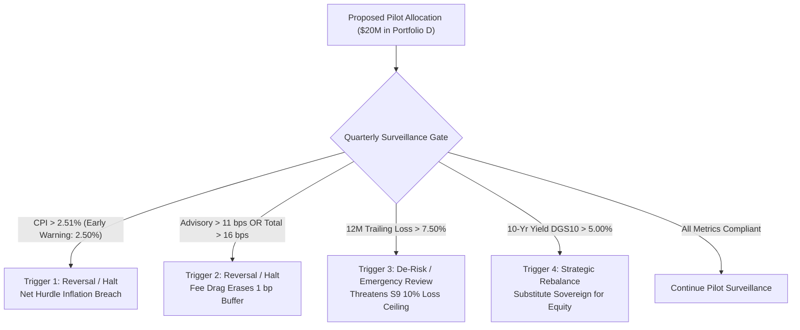

# Meridian Foundation Reserve — Investment Committee Decision Memo

**Target Account:** Meridian Foundation Reserve ($100.0M Total Capital Base)  
**Intended User:** Investment Committee / Chief Investment Officer  
**Author / Student:** Elliot  
**Course:** FIN 43900 — Applied Financial Modeling & Corporate Valuation (Daniels School of Business, Purdue University)  
**Date / Evaluation Horizon:** November 18, 2026 | Seven-Year Investment Horizon with Annual Rebalancing  
**Status:** PROPOSED RECOMMENDATION — Subject to Elliot's Review & Committee Approval  

---

> ### Required Opening Disclosures
> 1. **AI Use Disclosure:** This investment decision memorandum, quantitative model, and supporting application were developed with the assistance of artificial intelligence tools (Google Gemini / Antigravity) for code generation, mathematical scaffolding, and initial text drafting. Elliot directed the modeling architecture, established the mandate constraints and test cases, independently authored the pre-execution predictions with AI closed, reviewed and verified all executed outputs, and bears ultimate student responsibility for the submitted analysis and decision framework.
> 2. **Regulatory & Academic Disclaimer:** This memorandum is an educational demonstration prepared for FIN 43900 at Purdue University and does not constitute formal investment advice, legal counsel, or a professional fiduciary solicitation.

---

## 1. Executive Summary & Proposed Committee Action

### Primary Proposal: Conditional Pilot Allocation ($20.0M) to Portfolio D
The Investment Committee is presented with a **proposed analyst recommendation** to approve a **Conditional Pilot Allocation of $20.0 Million** to **Portfolio D** (`[0% Treasury bills, 20% 10-Year Treasuries, 20% Investment-Grade Bonds, 60% Global Equities]`). This recommendation requires formal review and approval by Elliot and the Committee prior to implementation.

The Committee is explicitly cautioned **against an unconditional, immediate $100.0 Million capital deployment**. While Portfolio D satisfies all evaluated mechanical constraints and mathematically achieves the client's 6.50% net return hurdle, its net margin of safety is exceptionally narrow (exactly 1.0 basis point), and Statement S9's downside loss limitation remains an unresolved condition under standard market distributions.

### Management of the Remaining $80.0 Million Capital Base:
During the initial 12-month pilot phase, the remaining **$80.0 Million** of the foundation reserve is to remain in the institution's existing conservative short-term sovereign reserve structure (primarily Treasury bills and short-duration sovereign paper). 

*Critical Fiduciary Clarification:* We do not invent an unobserved asset allocation for the unallocated $80.0M, nor do we assert that the entire $100.0M reserve fund currently satisfies the mandate. Full mandate compliance can only be evaluated for capital that has been formally modeled and allocated. Transitioning the remaining $80.0M into Portfolio D is strictly contingent upon quarterly surveillance gates and resolution of Statement S9.

### Summary of Comparative Portfolio Findings:
1. **Equal Weight Baseline (25% each):** Holds superior liquidity (50.0% reserve share) and low volatility (5.21%), but **fails the return objective** (Gross 5.20% / Net 5.07% vs. 6.50% required net). It cannot preserve the purchasing power of the reserve while supporting distributions.
2. **Strategic 60/40 Benchmark (40% IG Bonds / 60% Equity):** Clears the return target (Gross 6.80% / Net 6.64%) at 10.46% volatility, but **violates the client's own mandate** by holding **0.0% in reserve-eligible assets**, breaching the mandatory 3.0% floor (Statement S3).
3. **Portfolio C (Gross-Optimized, Lab 15 Test A):** Allocates `[0% Bills, 20% 10-Yr, 25% IG, 55% Eq]`. It achieves 6.51% gross return and reduces volatility to 9.44%, but after accounting for institutional advisory drag (10 bps) and fund expenses (4.9 bps), its net return falls to **6.36%**, failing the 6.50% net mandate hurdle (Statement S4).
4. **Portfolio D (Net-Optimized Candidate):** Allocates `[0% Bills, 20% 10-Yr, 20% IG, 60% Eq]`. It achieves **6.66% gross return** and **6.51% net return** after all fund sleeve (5.0 bps) and advisory/custody costs (10.0 bps), clearing the 6.50% net hurdle while maintaining a 20.0% reserve allocation and 10.07% annualized volatility.

---

## 2. Institutional Mandate & Asset Universe

The Meridian Foundation Reserve ($100.0M) is governed by four core mandate provisions:
- **Annual Distribution Commitment:** $0.75M per quarter (**$3.0M annually**).
- **Mandatory Reserve Floor (Statement S3):** Four quarters of distributions held exclusively in daily-liquid sovereign debt:
  $$\text{Reserve Floor} = \frac{4 \times \$0.75\text{M}}{\$100.0\text{M}} = 3.00\% \quad (\$3,000,000)$$
- **Purchasing Power Return Objective (Statement S4):** Preserve capital real value over rolling five-year periods:
  $$\text{Nominal Hurdle} = \text{CPI Baseline } (2.50\%) + \text{Real Growth Target } (4.00\%) = 6.50\% \text{ net of all investment costs}$$
- **Liquidity & Issuer Diversification (Statements S5 & S6):** Minimum 90.0% redeemable within 5 business days; maximum 8.0% exposure to any single corporate issuer.

| Holding Sleeve | Asset Class | Expected Gross Return | Annual Volatility | Reserve-Eligible? | Redemption Window | Single-Issuer Concentration |
|---|---|:---:|:---:|:---:|:---:|:---:|
| **Treasury bills** | Cash Equivalents / Sovereign | 3.50% | 0.50% | **Yes** | 1 business day | Exempt under Mandate S6 (U.S. Sovereign) |
| **Treasury 10-year note** | Intermediate Sovereign Debt | 4.30% | 7.00% | **Yes** | 1 business day | Exempt under Mandate S6 (U.S. Sovereign) |
| **Investment-grade bond fund** | Corporate / Credit Index | 5.00% | 6.00% | No | 3 business days | Exempt under Mandate S6 (Pooled Fund Exemption) |
| **Global equity index fund** | Public Global Equities | 8.00% | 16.00% | No | 2 business days | Exempt under Mandate S6 (Pooled Fund Exemption) |

*Client Mandate Exemption Note:* The exemption from the 8.0% single-issuer cap is derived specifically from **Statement S6 of the client's internal investment policy mandate**, which exempts direct U.S. sovereign debt and diversified pooled index funds. It is not an external statutory legal exemption. Underlying corporate constituent holdings within the pooled funds are unobserved.

---

## 3. Side-by-Side Portfolio Comparative Analysis

The table below summarizes performance, fee drag, reserve compliance, tail risk, and mandate status across candidate allocations based on frozen model execution (`visible_output.json`):

| Portfolio Specification | Asset Weights (Bills / 10-Yr / IG / Eq) | Gross Return | Sleeve Drag | Advisory Drag | Net Return | Annual Volatility ($\sigma$) | Reserve Share | 1-Yr 5th Pct Net Return | 1-Yr 95% VaR ($ on $100M) | Mandate Status |
|---|:---:|:---:|:---:|:---:|:---:|:---:|:---:|:---:|:---:|:---|
| **Equal Weight** | 25% / 25% / 25% / 25% | 5.20% | 2.8 bps | 10.0 bps | 5.07% | 5.21% | 50.0% | -3.50% | $3.50M | **FAIL:** Return Target (-1.43 pp net) |
| **Strategic 60/40 Benchmark** | 0% / 0% / 40% / 60% | 6.80% | 5.8 bps | 10.0 bps | 6.64% | 10.46% | 0.0% | -10.57% | $10.57M | **FAIL:** Reserve Floor (0.0% < 3.0%) |
| **Portfolio C (Gross Opt)** | 0% / 20% / 25% / 55% | 6.51% | 4.9 bps | 10.0 bps | 6.36% | 9.44% | 20.0% | -9.17% | $9.17M | **FAIL:** Net Hurdle (-14 bps net) |
| **Portfolio D (Net Candidate)** | 0% / 20% / 20% / 60% | 6.66% | 5.0 bps | 10.0 bps | 6.51% | 10.07% | 20.0% | -10.05% | $10.05M | **Passes evaluated mechanical constraints (S3, S5, S6) & net hurdle (S4); S9 unresolved** |

---

## 4. Proposed Pilot Capital Allocation ($20.0M Pilot on $100.0M Base)

Under the proposed pilot deployment, capital is structured as follows:

```text
Proposed Reserve Capital Structure ($100.0M Total Base):
├── Active Pilot Allocation — Portfolio D ($20.0M, 20% of Reserve):
│   ├── 1. Cash / Treasury Bills (0.0%):           $0.0M  ($0)
│   ├── 2. 10-Year U.S. Treasuries (20.0%):        $4.0M  (20% of pilot; Reserve-Eligible)
│   ├── 3. Investment-Grade Bond Fund (20.0%):     $4.0M  (Expense: 4 bps = $1,600/yr)
│   └── 4. Global Equity Index Fund (60.0%):      $12.0M  (Expense: 7 bps = $8,400/yr)
└── Retained Sovereign Reserve ($80.0M, 80% of Reserve):
    └── Held in existing short-term Treasury bills / sovereign cash pending pilot review.
```

### Financial Accounting & Hurdle Clearance (Portfolio D Architecture):
- **Expected Gross Annual Return:** $6.6600\%$.
- **Fund Sleeve Expense Drag:** $5.0\text{ bps}$ ($0.0500\%$).
- **Portfolio Advisory & Custody Drag:** $10.0\text{ bps}$ ($0.1000\%$).
- **Total Investment Drag:** $15.0\text{ bps}$ ($0.1500\%$).
- **Expected Net Annual Return:** **$6.5100\%$** vs. **$6.5000\%$** Hurdle.
- **Net Margin of Safety (Buffer):** **$+1.0\text{ bp}$** ($+0.0100\%$, or $\$10,000$ per year per $\$100\text{M}$).

> [!WARNING]
> **Fiduciary Caution on Razor-Thin Cushion:**  
> Portfolio D clears the 6.50% net hurdle by exactly **1.0 basis point**. An advisory fee increase of just 1.1 bps, a tracking error drag of 2 bps, or inflation rising above 2.51% immediately pushes expected net return below the purchasing power hurdle.

---

## 5. Mandate Compliance, Tail Risk & Unresolved Conditions

### A. Evaluated Mechanical Constraints
- **Statement S3 (Reserve Floor):** **PASS.** 20.0% in 10-Year Treasuries exceeds the 3.0% floor.
- **Statement S5 (Five-Day Liquidity):** **PASS.** 100.0% of assets redeem in $\le 3$ business days (requirement $\ge 90.0\%$).
- **Statement S6 (Single-Issuer Concentration):** **PASS (0.00% Direct Corporate Issuer).** Evaluated holdings are 100% sovereign debt or pooled institutional funds exempt under Statement S6.
  - *Look-Through Credit Disclosure:* Headline 0.0% concentration reflects the client mandate exemption for pooled funds, not proof of zero corporate credit risk.

### B. Value-at-Risk Definition & Statement S9 Downside Risk
- **Rigorously Defining VaR:** Value-at-Risk (VaR) is a **modeled loss quantile threshold at a specified confidence level**, **not a ceiling on maximum possible loss**. In tail events beyond the 95th percentile, actual losses can significantly exceed the VaR threshold.
- **Parametric Normal Downside Metrics for Portfolio D ($\mu = 6.51\%$, $\sigma = 10.0658\%$):**
  - **1-Year 5th-Percentile Net Return:** $R_{0.05} = 6.51\% - 1.64485 \times 10.0658\% = \mathbf{-10.05\%}$.
  - **1-Year 95% Value-at-Risk (VaR):** **$10.05\%$** (or **$\$10.05\text{M}$** per $\$100\text{M}$ base). In 5% of years, annual losses are modeled to equal or exceed this threshold.
  - **Probability of Annual Loss Exceeding 10.0% (Statement S9 Breach):**
    $$P(\text{Return} < -10.0\%) = \Phi\left(\frac{-0.10 - 0.0651}{0.100658}\right) = \Phi(-1.6402) = \mathbf{5.05\%}$$
- **Fiduciary Reality Check on Statement S9:** Portfolio D carries an approximate **1-in-20 year modeled frequency** of losing more than 10.0% in a calendar year. Because any long-only allocation with 60% equities carries non-zero tail risk, Statement S9 cannot be guaranteed without cash or options collars that would reduce expected return below 6.50%. Statement S9 remains an **unresolved mandate condition**.

---

## 6. Changed-Input Stress Findings (Global Equity Return: 8.00% → 7.50%)

During the Phase 2 changed-input experiment (locked precommit `657453e`), Global Equity Expected Return was shocked from 8.00% to 7.50%:
1. **Case 1 (Fixed-Weight Sensitivity, No Rebalancing):** Net return drops to **$6.21\%$**, failing the 6.50% net hurdle by $-29\text{ bps}$.
2. **Case 2 (Grid-Search Reoptimization):** Solver shifts weights to `[0% Bills, 10% 10-Yr, 20% IG, 70% Equity]`, clearing net return ($6.52\% \ge 6.50\%$) but **surging annualized volatility from 10.07% to 11.57% (+150 bps)** and deepening 95% VaR to **$-12.51\%$** ($P(\text{Loss} > 10\%) = 7.66\%$).
3. **Strategic Conclusion:** Automated reoptimization exhibits aggressive hurdle-chasing behavior when asset return expectations degrade. The Committee must reject automated reoptimization and seek mandate amendments rather than taking excessive equity risk.

---

## 7. Operational Surveillance & Reversal Triggers

The proposed pilot approval of Portfolio D is governed by four non-negotiable reversal triggers:



1. **Trigger 1 — Inflation Acceleration Breach (CPI > 2.51%):**  
   Under the additive $\text{CPI} + 4.00\%$ methodology, headline trailing 12-month CPI exceeding **2.51%** raises the net hurdle above Portfolio D's 6.51% expected net return ($2.51\% + 4.00\% = 6.51\%$). **CPI = 2.50% is designated as an early-warning threshold** (where the net buffer is just 1.0 bp). Any CPI reading above 2.51% constitutes an immediate mandate breach, halting further deployment.
2. **Trigger 2 — Fee Drag Expansion (Advisory > 11 bps OR Total Expenses > 16 bps):**  
   Portfolio D has 5.0 bps in fund sleeve expenses and 10.0 bps in advisory/custody expenses (total 15.0 bps). Because the net return buffer is only 1.0 bp, **advisory expenses above 11.0 bps, or total expenses above 16.0 bps**, cause the expected net return to fall below 6.50% ($6.66\% - 0.1601\% < 6.50\%$). Such an increase triggers an immediate rebalancing freeze.
3. **Trigger 3 — Downside Drawdown Warning (Trailing 12-Month Net Loss > 7.50%):**  
   If the portfolio experiences a trailing 12-month net drawdown exceeding 7.50%, an emergency review is mandated to de-risk into Treasury bills before Statement S9's 10.0% calendar-year ceiling is breached.
4. **Trigger 4 — Macro Sovereign Opportunity Signal (FRED DGS10 > 5.00%):**  
   Point-in-time interest rate surveillance (FRED `DGS10`) serves as an opportunity signal. If 10-Year Treasury yields sustainably exceed 5.00%, the Committee should actively rebalance capital from equities into sovereign debt, capturing yield with lower tail risk.

---

## 8. Recommended Committee Action Items

1. **Review and Decide on Pilot Proposal:** Formally consider Elliot's proposed recommendation to deploy an initial $20.0M pilot into Portfolio D, keeping $80.0M in short-term sovereign paper.
2. **Mandate Clarification Request:** Submit a formal inquiry to the Meridian Foundation Board regarding Statement S9 (clarifying whether the 10.0% loss limit is an aspirational guideline or requires synthetic hedging).
3. **Fee Drag Contractual Cap:** Require investment management agreements to contractually cap advisory/custody expenses at 10.0 basis points annually.

*Submitted respectfully for consideration,*  
**Elliot**  
FIN 43900 | Daniels School of Business, Purdue University
