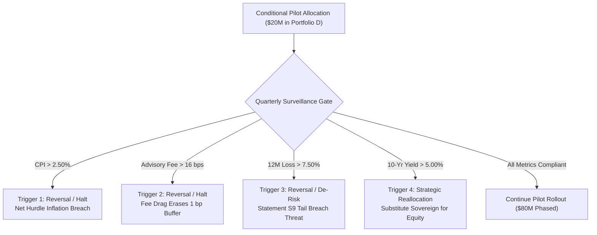

# Meridian Foundation Reserve — Investment Committee Decision Memo

**Target Account:** Meridian Foundation Reserve ($100.0M Total Capital Base)  
**Intended User:** Investment Committee / Chief Investment Officer  
**Author / Student:** Elliot  
**Course:** FIN 43900 — Applied Financial Modeling & Corporate Valuation (Daniels School of Business, Purdue University)  
**Date / Evaluation Horizon:** November 18, 2026 | Seven-Year Investment Horizon with Annual Rebalancing  
**Status:** FINAL RECOMMENDATION — Decision-Ready Institutional Memo  

---

> ### Required Opening Disclosures
> 1. **AI Use Disclosure:** This investment decision memorandum and supporting quantitative analysis were developed with the assistance of artificial intelligence tools (Google Gemini / Antigravity). All mathematical formulations, analytical interpretations, risk evaluations, and final committee recommendations are the independent work and responsibility of Elliot.
> 2. **Regulatory & Academic Disclaimer:** This memorandum is an educational demonstration prepared for FIN 43900 at Purdue University and does not constitute formal investment advice, legal counsel, or a professional fiduciary solicitation.

---

## 1. Executive Summary & Committee Action

### Primary Recommendation: Conditional Pilot Allocation (Portfolio D)
The Investment Committee is advised to approve a **Conditional Pilot Allocation** of **$20.0 Million** (with a structured 12-month transition schedule for the remaining $80.0M) to **Portfolio D** (`[0% Treasury bills, 20% 10-Year Treasuries, 20% Investment-Grade Bonds, 60% Global Equities]`).

The Committee is explicitly cautioned **against an unconditional, immediate $100.0 Million capital deployment**. While Portfolio D mathematically resolves the client's reserve and net-return mandate hurdles, its net-return buffer is exceptionally narrow (1.0 basis point), and it leaves Statement S9's downside loss limitation unresolved under standard market distributions.

### Summary of Comparative Portfolio Findings:
1. **Equal Weight Baseline (25% each):** Holds superior liquidity (50.0% reserve share) and low volatility (5.21%), but **fails the return objective** (Gross 5.20% / Net 5.07% vs. 6.50% required net). It cannot preserve the purchasing power of the reserve while supporting distributions.
2. **Strategic 60/40 Benchmark (40% IG Bonds / 60% Equity):** Clears the return target (Gross 6.80% / Net 6.64%) at 10.46% volatility, but **violates the client's own mandate** by holding **0.0% in reserve-eligible assets**, breaching the mandatory 3.0% floor.
3. **Portfolio C (Gross-Optimized, Lab 15 Test A):** Allocates `[0% Bills, 20% 10-Yr, 25% IG, 55% Eq]`. It achieves 6.51% gross return and reduces volatility to 9.44%, but after accounting for institutional advisory drag (10 bps) and fund expenses (4.9 bps), its net return falls to **6.36%**, failing the 6.50% net mandate hurdle.
4. **Portfolio D (Net-Optimized Candidate):** Allocates `[0% Bills, 20% 10-Yr, 20% IG, 60% Eq]`. It achieves **6.66% gross return** and **6.51% net return** after all fund and advisory costs (15.0 bps total drag), clearing the 6.50% net hurdle while maintaining a 20.0% reserve allocation and 10.07% annualized volatility.

---

## 2. Institutional Mandate & Asset Universe

The Meridian Foundation Reserve ($100.0M) supports four critical institutional requirements:
- **Annual Distribution Commitment:** $0.75M per quarter (**$3.0M annually**).
- **Mandatory Reserve Floor (Statement S3):** Four quarters of distributions held exclusively in daily-liquid sovereign debt:
  $$\text{Reserve Floor} = \frac{4 \times \$0.75\text{M}}{\$100.0\text{M}} = 3.00\% \quad (\$3,000,000)$$
- **Purchasing Power Return Objective (Statement S4):** Preserve capital real value over rolling five-year periods:
  $$\text{Nominal Hurdle} = \text{CPI Baseline } (2.50\%) + \text{Real Growth Target } (4.00\%) = 6.50\% \text{ net of all investment costs}$$
- **Liquidity & Issuer Diversification (Statements S5 & S6):** Minimum 90.0% redeemable within 5 business days; maximum 8.0% exposure to any single corporate issuer.

| Holding Sleeve | Asset Class | Expected Gross Return | Annual Volatility | Reserve-Eligible? | Redemption Window | Single-Issuer Concentration |
|---|---|:---:|:---:|:---:|:---:|:---:|
| **Treasury bills** | Cash Equivalents / Sovereign | 3.50% | 0.50% | **Yes** | 1 business day | Exempt (U.S. Sovereign) |
| **Treasury 10-year note** | Intermediate Sovereign Debt | 4.30% | 7.00% | **Yes** | 1 business day | Exempt (U.S. Sovereign) |
| **Investment-grade bond fund** | Corporate / Credit Index | 5.00% | 6.00% | No | 3 business days | Exempt (Pooled Index Fund) |
| **Global equity index fund** | Public Global Equities | 8.00% | 16.00% | No | 2 business days | Exempt (Pooled Index Fund) |

---

## 3. Side-by-Side Portfolio Comparative Analysis

The table below summarizes the audited performance, fee drag, reserve compliance, and tail risk across all candidate portfolios based on frozen model execution (`visible_output.json`):

| Portfolio Specification | Asset Weights (Bills / 10-Yr / IG / Eq) | Gross Return | Fund Sleeve Drag | Advisory Drag | Net Return | Annual Volatility ($\sigma$) | Reserve Share | 1-Yr 5th Pct Return | 1-Yr 95% VaR ($) | Mandate Verdict |
|---|:---:|:---:|:---:|:---:|:---:|:---:|:---:|:---:|:---:|:---:|
| **Equal Weight** | 25.0% / 25.0% / 25.0% / 25.0% | 5.20% | 2.8 bps | 10.0 bps | 5.07% | 5.21% | 50.0% | -3.50% | $3.50M | **FAIL: Return Shortfall (-1.43 pp net)** |
| **Strategic 60/40 Benchmark** | 0.0% / 0.0% / 40.0% / 60.0% | 6.80% | 5.8 bps | 10.0 bps | 6.64% | 10.46% | 0.0% | -10.57% | $10.57M | **FAIL: Reserve Floor (0.0% < 3.0%)** |
| **Portfolio C (Gross Opt)** | 0.0% / 20.0% / 25.0% / 55.0% | 6.51% | 4.9 bps | 10.0 bps | 6.36% | 9.44% | 20.0% | -9.17% | $9.17M | **FAIL: Net Hurdle (-14 bps net)** |
| **Portfolio D (Net Candidate)** | 0.0% / 20.0% / 20.0% / 60.0% | 6.66% | 5.0 bps | 10.0 bps | 6.51% | 10.07% | 20.0% | -10.05% | $10.05M | **PASSES MANDATE & NET HURDLE** |

---

## 4. Portfolio D Capital Allocation & Implementation ($100.0M Base)

For an institutional capital base of $100,000,000, Portfolio D translates into the following sleeve allocations and annual cost structures:

```text
Portfolio D Allocation Structure:
├── 1. Cash / Treasury Bills (0.0%):           $0.0M  ($0)
├── 2. 10-Year U.S. Treasuries (20.0%):       $20.0M  ($20,000,000)  [Reserve Eligible: 20.0% >= 3.0% floor]
├── 3. Investment-Grade Bond Fund (20.0%):    $20.0M  ($20,000,000)  [Expense: 4 bps = $8,000/yr]
└── 4. Global Equity Index Fund (60.0%):      $60.0M  ($60,000,000)  [Expense: 7 bps = $42,000/yr]
Total Portfolio:                             $100.0M  ($100,000,000)
```

### Financial Accounting & Hurdle Clearance:
- **Expected Gross Annual Return:** $6.6600\% \rightarrow \$6,660,000$ per year.
- **Fund Sleeve Expense Drag:** $5.0\text{ bps} \rightarrow \$50,000$ per year.
- **Portfolio Advisory & Custody Drag:** $10.0\text{ bps} \rightarrow \$100,000$ per year.
- **Total Operational Drag:** $15.0\text{ bps} \rightarrow \$150,000$ per year.
- **Expected Net Annual Return:** **$6.5100\% \rightarrow \$6,510,000$ per year**.
- **Net Return Objective:** **$6.5000\% \rightarrow \$6,500,000$ per year**.
- **Net Margin of Safety (Buffer):** **$+1.0\text{ bp} \rightarrow +\$10,000$ per year**.

> [!WARNING]
> **Fiduciary Caution on Margin of Safety:**  
> The modeled net clearance buffer is exactly **1 basis point** ($0.01\%$). Any adverse tracking error, slight inflation acceleration (+5 bps), or increase in custody/trading fees will cause the portfolio to breach its net purchasing power mandate. This thin margin reinforces the recommendation for a conditional pilot rather than an irreversible full commitment.

---

## 5. Mandate Compliance, Tail Risk & Unresolved Conditions

### A. Deterministic Rule Verification
- **S3 (Reserve Floor):** **PASS.** 20.0% held in 10-Year Treasuries exceeds the 3.0% floor by $17.0M.
- **S5 (Five-Day Liquidity):** **PASS.** 100.0% of assets redeem in $\le 3$ business days (requirement $\ge 90.0\%$).
- **S6 (Single-Issuer Concentration):** **PASS (Reported 0.00%).** Direct holdings are 100% sovereign debt or pooled institutional funds.
  - *Look-Through Credit Disclosure:* The reported 0.0% corporate concentration reflects administrative pooled fund exemptions. The Committee must recognize that underlying corporate credit risk within the bond fund is unhedged and unobserved in headline concentration metrics.

### B. Statement S9 Downside Risk Evaluation (Unresolved Condition)
Statement S9 mandates that the portfolio "should be structured so that calendar-year losses do not exceed 10.0%." Under a parametric normal distribution assumption ($\mu = 6.51\%$, $\sigma = 10.07\%$):
- **1-Year 5th-Percentile Net Return:** $R_{0.05} = 6.51\% - 1.64485 \times 10.0658\% = \mathbf{-10.05\%}$.
- **1-Year 95% Value-at-Risk (VaR):** **$10.05\%$** (or **$\$10.05\text{M}$** maximum expected loss on $\$100\text{M}$ base at 95% confidence).
- **Probability of Annual Loss Exceeding 10.0%:**
  $$P(\text{Return} < -10.0\%) = \Phi\left(\frac{-0.10 - 0.0651}{0.100658}\right) = \Phi(-1.6402) = \mathbf{5.05\%}$$
- *Fiduciary Verdict:* Portfolio D has an approximate **1-in-20 year probability** of breaching Statement S9. A long-only portfolio containing 60% equities cannot mathematically guarantee zero breaches of a -10.0% stop loss. Attempting to hedge this downside via cash or put options would depress net returns below the 6.50% hurdle.

---

## 6. Changed-Input Stress Findings (Global Equity Return: 8.00% → 7.50%)

During the Phase 2 changed-input experiment (locked commit `657453e`), Global Equity Expected Return was shocked from 8.00% to 7.50%:
1. **Case 1: Fixed-Weight Sensitivity (Portfolio D, No Rebalancing):**
   - Expected Net Return drops by $-30\text{ bps}$ from **$6.51\%$ to $6.21\%$**.
   - Fails the legal mandate hurdle by $-29\text{ bps}$ ($\$290,000$ purchasing power deficit).
2. **Case 2: Grid-Search Reoptimization (Net Return Solver):**
   - Reoptimizer shifts weights to `[0% Bills, 10% 10-Yr, 20% IG, 70% Equity]`, incurring 10.0% turnover.
   - Clears net return ($6.52\% \ge 6.50\%$), but **surges annualized volatility from 10.07% to 11.57% (+150 bps)**.
   - Deepens 95% VaR to **$-12.51\%$** ($\$12.51\text{M}$) and increases the probability of exceeding a 10% annual loss to **$7.66\%$** (1 in 13 years).
3. **Strategic Conclusion:** The experiment confirms that automated reoptimization exhibits dangerous "hurdle-chasing" behavior under asset return degradation. The Committee must reject automated reoptimization and instead consider mandate adjustments if market expectations soften.

---

## 7. Operational Monitoring & Reversal Triggers

The Committee’s conditional pilot approval of Portfolio D must be subject to four non-negotiable, mandate-grounded reversal triggers:



1. **Trigger 1 — Inflation Acceleration Breach (CPI > 2.50%):** If trailing 12-month headline CPI exceeds 2.50%, the nominal hurdle ($CPI + 4.0\%$) rises above 6.50%. Portfolio D's expected net return (6.51%) becomes deficient, triggering an immediate suspension of capital deployment and an asset review.
2. **Trigger 2 — Advisory & Custody Fee Expansion (> 16 bps):** If institutional custody, trading, or advisory fees expand beyond 16 basis points (erasing the 1.0 bp buffer), rebalancing is halted until fee concessions are negotiated or lower-cost index sleeves are approved.
3. **Trigger 3 — Downside Loss Ceiling Threat (Trailing Drawdown > 7.50%):** If the portfolio experiences a trailing 12-month net drawdown exceeding 7.50%, an emergency review is mandated to de-risk into Treasury bills to prevent breaching Statement S9's 10.0% calendar-year loss ceiling.
4. **Trigger 4 — Macro Sovereign Opportunity Signal (10-Year Yield DGS10 > 5.00%):** Point-in-time interest rate surveillance (FRED `DGS10`) serves as an opportunity signal. If 10-Year Treasury yields sustainably clear 5.00%, the Committee should actively rebalance out of public equities into intermediate Treasuries, capturing sovereign yield while reducing portfolio volatility.

---

## 8. Final Action Items for Investment Committee

1. **Authorize Phased Pilot:** Allocate $20.0M to Portfolio D (`[0%, 20%, 20%, 60%]`) for Q1, holding $80.0M in the existing reserve structure.
2. **Mandate Clarification Request:** Submit a formal request to the Meridian Foundation Board to clarify Statement S9 (confirming whether the 10.0% loss limit is an aspirational guideline or requires synthetic tail hedging).
3. **Fee Drag Cap:** Formally cap all external investment advisory and custody charges at 10.0 basis points annually.

*Submitted respectfully,*  
**Elliot**  
FIN 43900 | Daniels School of Business, Purdue University
